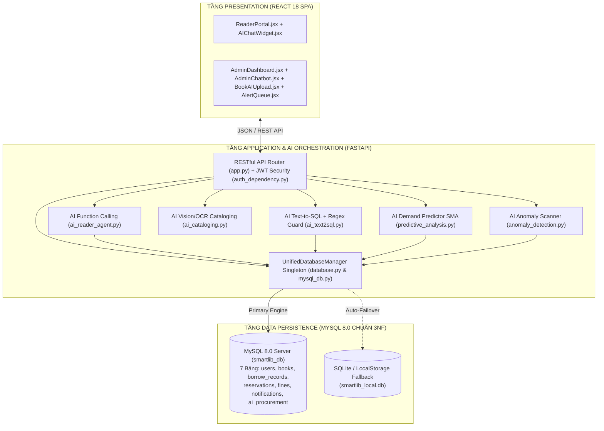
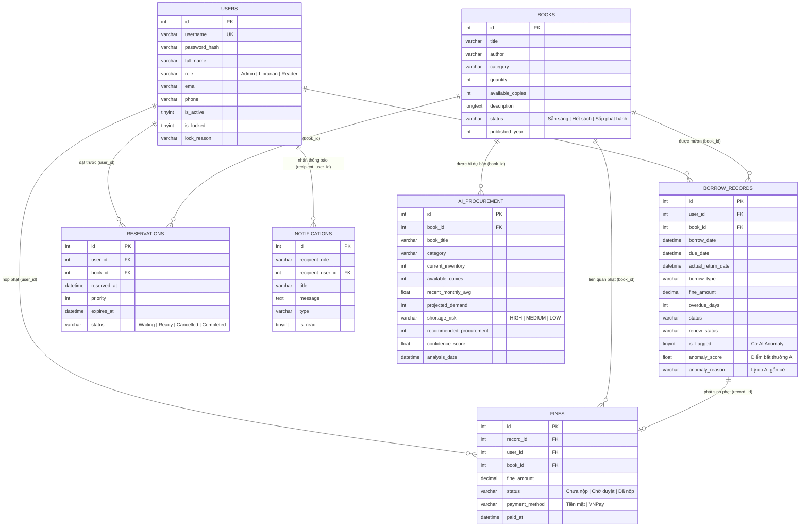

# 🗄️ SMARTLIB — THIẾT KẾ KIẾN TRÚC & CƠ SỞ DỮ LIỆU TOÀN DIỆN (ERD 7 BẢNG CHUẨN 3NF MYSQL 8.0)
**Mô hình Quan hệ Logic Chuẩn hóa, Kiến trúc Dual-Mode Persistence & Các Trường Dữ liệu Phục vụ AI**
> **Học phần:** Ứng dụng trí tuệ nhân tạo | **Lớp:** K23.K1.KTPM K23A, B (HK1 2026–2027)  
> **Giảng viên giảng dạy:** Nguyễn Thị Tuyển | **Khoa:** Công nghệ thông tin - ĐH CNTT&TT Thái Nguyên (ICTU)  
> **Sinh viên thực hiện:** Nguyễn Trung Học — **MSSV:** DTC245180174  
> **Chuẩn đầu ra đáp ứng:** `CLO1`, `CLO4` (Tiêu chí `1.3 Kiến trúc, CSDL hợp lý` & `1.4 Lý giải vị trí AI`)  
> 📖 **Bộ tài liệu kỹ thuật SmartLib:** [📋 Yêu cầu (SRS)](requirements.md) | [📊 Ca sử dụng & Kiểm thử](use_cases.md) | [🗄️ Thiết kế CSDL (ERD 7 Bảng)](database_design.md) | [🤖 Nhật ký Prompt & AI Log](ai_log.md) | [🏠 Trang chủ README](../README.md)

---

## MỤC LỤC
1. [Tổng quan Kiến trúc Hệ thống 3 Tầng & Dual-Mode Persistence](#1-tổng-quan-kiến-trúc-hệ-thống-3-tầng--dual-mode-persistence)
2. [Sơ đồ Quan hệ Thực thể (ERD 7 Bảng Chuẩn 3NF)](#2-sơ-đồ-quan-hệ-thực-thể-erd-7-bảng-chuẩn-3nf)
3. [Đặc tả Chi tiết Cấu trúc 7 Bảng Dữ liệu (Kèm Trường Phục vụ AI)](#3-đặc-tả-chi-tiết-cấu-trúc-7-bảng-dữ-liệu)
   - [3.1. Bảng `users` (Tài khoản & Phân quyền RBAC 3 vai trò)](#31-bảng-users-tài-khoản--hồ-sơ-3-vai-trò)
   - [3.2. Bảng `books` (Kho sách - 60 đầu sách & AI Metadata)](#32-bảng-books-kho-sách---60-đầu-sách)
   - [3.3. Bảng `borrow_records` (Phiếu mượn - trả & Cờ AI Anomaly Detection)](#33-bảng-borrow_records-phiếu-mượn---trả--cờ-ai-anomaly-detection)
   - [3.4. Bảng `reservations` (Hàng đợi đặt trước sách FIFO 48h)](#34-bảng-reservations-hàng-đợi-đặt-trước-sách-fifo-48h)
   - [3.5. Bảng `fines` (Quản lý phí phạt quá hạn & Thanh toán VNPay)](#35-bảng-fines-xử-lý-phạt-quá-hạn-2000-đngày)
   - [3.6. Bảng `notifications` (Thông báo thời gian thực đa vai trò)](#36-bảng-notifications-thông-báo-đa-vai-trò)
   - [3.7. Bảng `ai_procurement` (Kết quả AI Dự báo Nhu cầu Nhập sách)](#37-bảng-ai_procurement-kết-quả-ai-dự-báo-nhu-cầu-nhập-sách)
4. [Ánh xạ CSDL vào Schema Prompt cho AI Text-to-SQL & Function Calling](#4-ánh-xạ-csdl-vào-schema-prompt-cho-ai-text-to-sql--function-calling)
5. [Quy chuẩn Ràng buộc Toàn vẹn & Khóa ngoại (ACID)](#5-quy-chuẩn-ràng-buộc-toàn-vẹn--khóa-ngoại)
6. [Tập lệnh SQL DDL Khởi tạo CSDL MySQL 8.0](#6-tập-lệnh-sql-ddl-khởi-tạo-csdl-mysql-80)

---

## 1. TỔNG QUAN KIẾN TRÚC HỆ THỐNG 3 TẦNG & DUAL-MODE PERSISTENCE

Dự án **SmartLib** được thiết kế theo kiến trúc 3 tầng hiện đại, vận hành trực tiếp trên hệ quản trị cơ sở dữ liệu quan hệ **MySQL 8.0** qua **SQLAlchemy 2.0 ORM + PyMySQL Connection Pooling**, đồng thời tích hợp cơ chế **Dual-Mode Persistence Architecture** (tự động đồng bộ sang SQLite cục bộ / LocalStorage khi chạy môi trường tĩnh) giúp hệ thống đạt độ sẵn sàng 100%:

---

## 2. SƠ ĐỒ QUAN HỆ THỰC THỂ (ERD 7 BẢNG CHUẨN 3NF)

Cơ sở dữ liệu `smartlib_db` đạt chuẩn chuẩn hóa **3NF (Third Normal Form)**: mọi thuộc tính không khóa đều phụ thuộc hàm đầy đủ và trực tiếp vào khóa chính, không có phụ thuộc bắc cầu.

---

## 3. ĐẶC TẢ CHI TIẾT CẤU TRÚC 7 BẢNG DỮ LIỆU

### 3.1. Bảng `users` (Tài khoản & Hồ sơ 3 vai trò)
Lưu trữ thông tin xác thực và phân quyền RBAC cho 3 nhóm đối tượng: Quản trị viên (`Admin`), Thủ thư (`Librarian`), Độc giả (`Reader`).

| Tên Cột | Kiểu Dữ Liệu | Ràng Buộc | Ý Nghĩa / Ghi Chú |
| :--- | :--- | :--- | :--- |
| `id` | `INT` | PRIMARY KEY, AUTO_INCREMENT | Mã định danh người dùng duy nhất |
| `username` | `VARCHAR(50)` | NOT NULL, UNIQUE, INDEX | Tên đăng nhập hệ thống (`admin`, `librarian`, `reader`...) |
| `password_hash` | `VARCHAR(256)` | NOT NULL | Chuỗi băm mật khẩu bảo mật SHA-256 (Bị chặn truy xuất trong AI Text-to-SQL) |
| `full_name` | `VARCHAR(100)` | NOT NULL | Họ và tên đầy đủ của người dùng |
| `role` | `VARCHAR(50)` | NOT NULL, DEFAULT `'Reader'` | Phân quyền 3 cấp: `'Admin'`, `'Librarian'`, `'Reader'` |
| `email` | `VARCHAR(100)` | NULLABLE | Thư điện tử nhận thông báo |
| `phone` | `VARCHAR(30)` | NULLABLE | Số điện thoại liên hệ |
| `address` | `VARCHAR(255)` | NULLABLE | Địa chỉ liên lạc / Ký túc xá |
| `birth_date` | `DATE` | NULLABLE | Ngày tháng năm sinh |
| `is_active` | `TINYINT(1)` | NOT NULL, DEFAULT `1` | Trạng thái hoạt động (`1`: Hoạt động, `0`: Ngưng) |
| `is_locked` | `TINYINT(1)` | NOT NULL, DEFAULT `0` | Trạng thái khóa thẻ (`1`: Bị khóa do vi phạm, `0`: Bình thường) |
| `lock_reason` | `VARCHAR(255)` | NULLABLE | Lý do khóa tài khoản (quá hạn lâu ngày / làm mất sách) |

---

### 3.2. Bảng `books` (Kho sách - 60 đầu sách)
Quản lý danh mục sách thực tế trong thư viện, hỗ trợ cả dữ liệu trích xuất từ module **AI Book Cataloging** (`ai_cataloging.py`).

| Tên Cột | Kiểu Dữ Liệu | Ràng Buộc | Ý Nghĩa / Ghi Chú |
| :--- | :--- | :--- | :--- |
| `id` | `INT` | PRIMARY KEY, AUTO_INCREMENT | Mã số sách duy nhất |
| `title` | `VARCHAR(255)` | NOT NULL, INDEX | Tựa đề sách |
| `author` | `VARCHAR(100)` | NOT NULL, DEFAULT `'Chưa rõ'` | Tên tác giả |
| `category` | `VARCHAR(100)` | NOT NULL, DEFAULT `'Chung'`, INDEX | Thể loại (`Công nghệ`, `Kinh tế`, `Văn học`, `Kỹ năng sống`...) |
| `quantity` | `INT` | NOT NULL, DEFAULT `1` | Tổng số lượng bản sách nhập kho |
| `available_copies`| `INT` | NOT NULL, DEFAULT `1` | Số lượng sách khả dụng hiện tại ($0 \le \text{available\_copies} \le \text{quantity}$) |
| `description` | `LONGTEXT` | NULLABLE | Tóm tắt nội dung sách (phục vụ AI RAG & Summarizer) |
| `image_url` | `LONGTEXT` | NULLABLE | Đường dẫn hoặc chuỗi Base64 ảnh bìa sách |
| `status` | `VARCHAR(50)` | NOT NULL, DEFAULT `'Sẵn sàng'` | Trạng thái: `'Sẵn sàng'`, `'Hết sách'`, `'Sắp phát hành'` |
| `published_year` | `INT` | NULLABLE | Năm xuất bản |

---

### 3.3. Bảng `borrow_records` (Phiếu mượn - trả & Cờ AI Anomaly Detection)
Theo dõi giao dịch mượn trả, gia hạn và tích hợp 3 trường chuyên biệt phục vụ **AI Anomaly Detection** (`anomaly_detection.py`).

| Tên Cột | Kiểu Dữ Liệu | Ràng Buộc | Ý Nghĩa / Ghi Chú |
| :--- | :--- | :--- | :--- |
| `id` | `INT` | PRIMARY KEY, AUTO_INCREMENT | Mã phiếu mượn |
| `user_id` | `INT` | NOT NULL, FK $\rightarrow$ `users(id)` | Khóa ngoại người mượn |
| `book_id` | `INT` | NOT NULL, FK $\rightarrow$ `books(id)` | Khóa ngoại cuốn sách mượn |
| `borrow_date` | `DATETIME` | NOT NULL, DEFAULT CURRENT_TIMESTAMP | Thời điểm bắt đầu mượn |
| `due_date` | `DATETIME` | NOT NULL | Hạn chót hoàn trả sách |
| `actual_return_date`| `DATETIME` | NULLABLE | Thời điểm thực tế hoàn trả sách tại quầy |
| `borrow_type` | `VARCHAR(50)` | NOT NULL, DEFAULT `'Mượn về nhà'` | Hình thức: `'Mượn về nhà'` hoặc `'Đọc tại chỗ'` |
| `fine_amount` | `DECIMAL(12,2)`| NOT NULL, DEFAULT `0.00` | Số tiền phạt quá hạn (`2.000 đ/ngày`) |
| `overdue_days` | `INT` | NOT NULL, DEFAULT `0` | Số ngày quá hạn |
| `status` | `VARCHAR(50)` | NOT NULL, DEFAULT `'Chờ duyệt'` | `'Chờ duyệt'`, `'Đang mượn'`, `'Đã trả'`, `'Từ chối'`, `'Báo mất'` |
| `renew_status` | `VARCHAR(50)` | NULLABLE | `'Chờ duyệt gia hạn'`, `'Đã gia hạn'`, `'Từ chối gia hạn'` |
| `pending_renew_days`| `INT` | NULLABLE | Số ngày độc giả xin gia hạn thêm |
| `renew_count` | `INT` | NOT NULL, DEFAULT `0` | Số lần đã gia hạn |
| `is_flagged` | `BOOLEAN` | DEFAULT `0` | **[AI Anomaly]** Cờ đánh dấu giao dịch bất thường (`1`: Bất thường) |
| `anomaly_score` | `FLOAT` | DEFAULT `0.0` | **[AI Anomaly]** Điểm rủi ro bất thường ($0.0 \rightarrow 1.0$, cảnh báo khi $> 0.8$) |
| `anomaly_reason` | `VARCHAR(500)` | NULLABLE | **[AI Anomaly]** Giải thích lý do AI gắn cờ (mượn-trả $< 15$ phút / mất $\ge 5$ cuốn) |

---

### 3.4. Bảng `reservations` (Hàng đợi đặt trước sách FIFO 48h)
Giải quyết bài toán độc giả đặt chỗ trước khi sách hết kho (`available_copies = 0`).

| Tên Cột | Kiểu Dữ Liệu | Ràng Buộc | Ý Nghĩa / Ghi Chú |
| :--- | :--- | :--- | :--- |
| `id` | `INT` | PRIMARY KEY, AUTO_INCREMENT | Mã đặt trước |
| `user_id` | `INT` | NOT NULL, FK $\rightarrow$ `users(id)` | Khóa ngoại độc giả đặt trước |
| `book_id` | `INT` | NOT NULL, FK $\rightarrow$ `books(id)` | Khóa ngoại cuốn sách đặt trước |
| `reserved_at` | `DATETIME` | NOT NULL, DEFAULT CURRENT_TIMESTAMP | Thời điểm đăng ký (xếp hàng FIFO) |
| `priority` | `INT` | NOT NULL, DEFAULT `1` | Thứ tự ưu tiên trong hàng đợi |
| `expires_at` | `DATETIME` | NOT NULL | Thời hạn giữ sách 48h kể từ khi có sách trả về |
| `status` | `VARCHAR(50)` | NOT NULL, DEFAULT `'Waiting'` | `'Waiting'`, `'Ready'`, `'Cancelled'`, `'Completed'` |

---

### 3.5. Bảng `fines` (Xử lý phạt quá hạn 2.000 đ/ngày)
Quản lý các khoản phạt trễ hạn hoặc đền bù mất sách, hỗ trợ thanh toán Tiền mặt và VNPay QR.

| Tên Cột | Kiểu Dữ Liệu | Ràng Buộc | Ý Nghĩa / Ghi Chú |
| :--- | :--- | :--- | :--- |
| `id` | `INT` | PRIMARY KEY, AUTO_INCREMENT | Mã phiếu phạt |
| `record_id` | `INT` | NOT NULL, FK $\rightarrow$ `borrow_records(id)` | Khóa ngoại phiếu mượn phát sinh phạt |
| `user_id` | `INT` | NOT NULL, FK $\rightarrow$ `users(id)` | Khóa ngoại độc giả bị phạt |
| `book_id` | `INT` | NOT NULL, FK $\rightarrow$ `books(id)` | Khóa ngoại cuốn sách liên quan |
| `due_date` | `DATETIME` | NOT NULL | Hạn trả quy định |
| `actual_return_date`| `DATETIME` | NOT NULL | Ngày trả thực tế |
| `fine_amount` | `DECIMAL(12,2)`| NOT NULL, DEFAULT `0.00` | Số tiền phạt ($\text{overdue\_days} \times 2.000\text{ đ}$) |
| `status` | `VARCHAR(50)` | NOT NULL, DEFAULT `'Chưa nộp'` | `'Chưa nộp'`, `'Chờ duyệt'`, `'Đã nộp'` |
| `payment_method` | `VARCHAR(50)` | NOT NULL, DEFAULT `'Tiền mặt'` | `'Tiền mặt'` hoặc `'VNPay'` |
| `transaction_ref` | `VARCHAR(100)` | NULLABLE | Mã giao dịch thanh toán VNPay |
| `paid_at` | `DATETIME` | NULLABLE | Thời điểm hoàn tất nộp phạt |

---

### 3.6. Bảng `notifications` (Thông báo đa vai trò)
Lưu trữ thông báo thời gian thực gửi đến từng cá nhân hoặc từng nhóm vai trò.

| Tên Cột | Kiểu Dữ Liệu | Ràng Buộc | Ý Nghĩa / Ghi Chú |
| :--- | :--- | :--- | :--- |
| `id` | `INT` | PRIMARY KEY, AUTO_INCREMENT | Mã thông báo |
| `recipient_role` | `VARCHAR(20)` | NOT NULL, INDEX | Vai trò nhận: `'all'`, `'Reader'`, `'Librarian'`, `'Admin'` |
| `recipient_user_id` | `INT` | NULLABLE, FK $\rightarrow$ `users(id)` | Khóa ngoại người nhận cụ thể |
| `title` | `VARCHAR(255)` | NOT NULL | Tiêu đề thông báo |
| `message` | `TEXT` | NOT NULL | Nội dung chi tiết |
| `type` | `VARCHAR(50)` | NOT NULL, DEFAULT `'general'` | Loại sự kiện (`borrow_approved`, `overdue_fine`, `reserved_ready`...) |
| `is_read` | `TINYINT(1)` | NOT NULL, DEFAULT `0` | `0`: Chưa đọc, `1`: Đã đọc |

---

### 3.7. Bảng `ai_procurement` (Kết quả AI Dự báo Nhu cầu Nhập sách)
Bảng chuyên biệt lưu trữ đầu ra của thuật toán dự báo nhu cầu mượn sách (`backend/predictive_analysis.py`) giúp Admin lập kế hoạch mua sắm sách mới.

| Tên Cột | Kiểu Dữ Liệu | Ràng Buộc | Ý Nghĩa / Ghi Chú |
| :--- | :--- | :--- | :--- |
| `id` | `INT` | PRIMARY KEY, AUTO_INCREMENT | Mã bản ghi dự báo |
| `book_id` | `INT` | NOT NULL, INDEX | Mã đầu sách được phân tích |
| `book_title` | `VARCHAR(255)` | NOT NULL | Tên đầu sách |
| `category` | `VARCHAR(100)` | NULLABLE | Thể loại sách |
| `current_inventory`| `INT` | NOT NULL, DEFAULT `0` | Tổng số lượng tồn kho hiện có |
| `available_copies` | `INT` | NOT NULL, DEFAULT `0` | Số bản sẵn có hiện tại |
| `recent_monthly_avg`| `FLOAT` | NOT NULL, DEFAULT `0.0` | Trung bình lượt mượn 3 tháng gần nhất (SMA) |
| `projected_demand` | `INT` | NOT NULL, DEFAULT `0` | Nhu cầu mượn dự báo cho tháng tới |
| `shortage_risk` | `VARCHAR(50)` | NOT NULL, DEFAULT `'HIGH'` | Mức độ nguy cơ thiếu hụt: `'HIGH'`, `'MEDIUM'`, `'LOW'` |
| `recommended_procurement`| `INT` | NOT NULL, DEFAULT `0` | Số lượng cuốn sách AI khuyến nghị nhập thêm |
| `confidence_score` | `FLOAT` | NOT NULL, DEFAULT `0.0` | Độ tin cậy của dự báo ($0.0 \rightarrow 1.0$) |
| `analysis_date` | `DATETIME` | NOT NULL | Thời điểm chạy mô hình dự báo |
| `notes` | `TEXT` | NULLABLE | Giải thích chi tiết xu hướng tăng trưởng của AI |

---

## 4. ÁNH XẠ CSDL VÀO SCHEMA PROMPT CHO AI TEXT-TO-SQL & FUNCTION CALLING

Để LLM sinh câu lệnh SQL chính xác 100% mà không bị lỗi tên cột (Hallucination) và không làm lộ dữ liệu mật, hệ thống sử dụng kỹ thuật **Schema Pruning (Tỉa gọn Schema)** khi đưa vào `DATABASE_SCHEMA_PROMPT` trong [`backend/ai_text2sql.py`](file:///d:/UDAI/Thuvien/backend/ai_text2sql.py):
- Chỉ cung cấp tên bảng, tên cột nghiệp vụ và các giá trị `ENUM` tiếng Việt thực tế (`'Sẵn sàng'`, `'Hết sách'`, `'Chờ duyệt'`, `'Đang mượn'`, `'Đã trả'`).
- **Ẩn hoàn toàn cột `password_hash`** khỏi `DATABASE_SCHEMA_PROMPT` gửi cho LLM, kết hợp thêm bộ lọc Regex tại tầng Backend chặn mọi truy vấn cố tình chạm vào từ khóa `password` hoặc `password_hash`.

---

## 5. QUY CHUẨN RÀNG BUỘC TOÀN VẸN & KHÓA NGOẠI

1. **Toàn vẹn khóa ngoại (Referential Integrity):** Mọi bảng giao dịch (`borrow_records`, `reservations`, `fines`, `notifications`) đều gắn khóa ngoại `FOREIGN KEY` tham chiếu tới `users(id)` và `books(id)`. Ở tầng nghiệp vụ (`app.py`), hệ thống kiểm tra và chặn xóa sách/độc giả đang có giao dịch hoạt động.
2. **Công thức bất biến tồn kho:**
   $$\text{available\_copies} = \text{quantity} - \sum (\text{bản ghi đang mượn})$$
   Mọi thao tác duyệt mượn và nhận trả sách đều được bảo vệ bởi `borrow_concurrency_lock` (`threading.Lock()`) và Transaction CSDL để chống Race Condition khi nhiều độc giả mượn cùng lúc.

---

## 6. TẬP LỆNH SQL DDL KHỞI TẠO CSDL MYSQL 8.0

Tập lệnh khởi tạo đầy đủ 6 bảng cốt lõi và dữ liệu mẫu nằm tại [`database/smartlib_mysql.sql`](file:///d:/UDAI/Thuvien/database/smartlib_mysql.sql), và bảng thứ 7 (`ai_procurement`) cùng các cột Anomaly Detection được khởi tạo tự động qua migration trong [`backend/predictive_analysis.py`](file:///d:/UDAI/Thuvien/backend/predictive_analysis.py) và [`backend/anomaly_detection.py`](file:///d:/UDAI/Thuvien/backend/anomaly_detection.py).

---

*Tài liệu Thiết kế Cơ sở Dữ liệu này đáp ứng trọn vẹn Tiêu chí 1.3 và CLO4 trong Barem đánh giá học phần Ứng dụng trí tuệ nhân tạo.*
