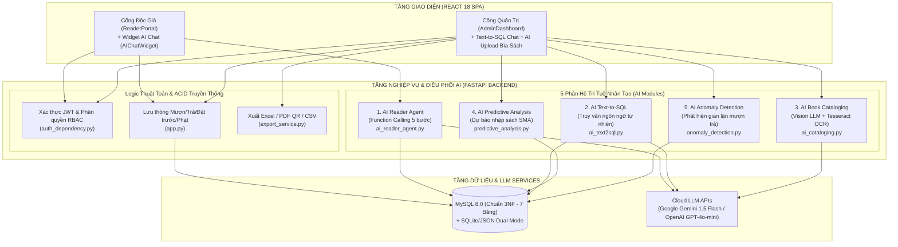

# 📋 SMARTLIB — ĐẶC TẢ YÊU CẦU PHẦN MỀM & GIẢI PHÁP AI (SRS)
**Hệ thống Quản lý Thư viện Thông minh Tích hợp Trí tuệ Nhân tạo Tạo sinh**
> **Học phần:** Ứng dụng trí tuệ nhân tạo | **Lớp:** KTPM K23B (HK1 2026–2027)  
> **Giảng viên giảng dạy:** Nguyễn Thị Tuyển | **Khoa:** Công nghệ thông tin - ĐH CNTT&TT Thái Nguyên (ICTU)  
> **Nhóm sinh viên thực hiện (KTPM K23B):** Vũ Hồng Dũng (Nhóm Trưởng - DTC245180068), Nguyễn Trung Học (DTC245180174), Lê Quang Hưng (DTC245180036)  
> **Chuẩn đầu ra đáp ứng:** `CLO1`, `CLO2`, `CLO4`, `PLO7` (Tiêu chí `1.1`, `1.2`, `1.3`, `1.4`)  
> 📖 **Bộ tài liệu kỹ thuật SmartLib:** [📋 Yêu cầu (SRS)](requirements.md) | [📊 Ca sử dụng & Kiểm thử](use_cases.md) | [🗄️ Thiết kế CSDL (ERD 7 Bảng)](database_design.md) | [🤖 Nhật ký Prompt & AI Log](ai_log.md) | [🏠 Trang chủ README](../README.md)

---

## MỤC LỤC
1. [Phân tích bài toán và Nghiệp vụ cốt lõi (Tiêu chí 1.1)](#1-phân-tích-bài-toán-và-nghiệp-vụ-cốt-lõi-tiêu-chí-11)
2. [Lý giải vị trí AI và Phân định Ranh giới Kỹ thuật (Tiêu chí 1.4 - CLO1, PLO7)](#2-lý-giải-vị-trí-ai-và-phân-định-ranh-giới-kỹ-thuật-tiêu-chí-14)
3. [Yêu cầu chức năng chi tiết (Bảng F01 - F45) (Tiêu chí 1.2)](#3-yêu-cầu-chức-năng-chi-tiết-tiêu-chí-12)
4. [Yêu cầu phi chức năng & Bảo mật AI (Non-Functional Requirements)](#4-yêu-cầu-phi-chức-năng--bảo-mật-ai)
5. [Ràng buộc hệ thống & Toàn vẹn dữ liệu (Tiêu chí 1.3)](#5-ràng-buộc-hệ-thống--toàn-vẹn-dữ-liệu-tiêu-chí-13)
6. [Kiến trúc hệ thống và Môi trường triển khai](#6-kiến-trúc-hệ-thống-và-môi-trường-triển-khai)

---

## 1. PHÂN TÍCH BÀI TOÁN VÀ NGHIỆP VỤ CỐT LÕI (TIÊU CHÍ 1.1)

### 1.1. Bối cảnh và Bài toán thực tế
Trong công tác vận hành thư viện đại học hiện nay, cả **Thủ thư** lẫn **Độc giả (Sinh viên)** thường gặp phải 4 điểm nghẽn lớn:
1. **Tra cứu thụ động theo từ khóa cứng:** Sinh viên mới nhập học thường tìm sách theo *nhu cầu thực tế* (ví dụ: *"Em hay bị run khi thuyết trình trước đám đông thì nên đọc sách gì?"*) chứ không nhớ chính xác tên sách hay tên tác giả để gõ vào ô tìm kiếm SQL `LIKE '%...%'`.
2. **Tốn thời gian biên mục sách mới:** Khi nhập hàng trăm đầu sách mới, thủ thư phải gõ tay từng trường Tên sách, Tác giả, Nhà xuất bản, Thể loại, Mô tả vào hệ thống, dễ xảy ra sai sót chính tả.
3. **Độ trễ trong truy vấn thống kê quản trị:** Khi Ban giám hiệu hoặc Thủ thư cần các báo cáo đột xuất (ví dụ: *"Liệt kê các độc giả đang nợ tiền phạt trễ hạn kèm số điện thoại"*, *"Top sách mượn nhiều nhất"*), các biểu đồ cố định trên giao diện không đáp ứng hết các lát cắt dữ liệu linh hoạt.
4. **Rủi ro thất thoát kho sách và thiếu hụt đầu sách hot:** Việc phát hiện các hành vi mượn-trả bất thường (mượn rồi trả ngay dưới 15 phút để cày điểm, hoặc liên tục báo mất sách quý) cũng như dự báo số lượng sách cần nhập thêm cho học kỳ tới nếu làm thủ công sẽ thiếu chính xác.

**Giải pháp SmartLib:** Xây dựng Hệ thống Quản lý Thư viện Thông minh kết hợp chặt chẽ giữa **Nghiệp vụ Quản trị Chuẩn xác (CRUD, Lưu thông, Đặt trước FIFO 48h, Xác thực QR, Quản lý Phạt)** và **Hệ sinh thái 5 Module Trí tuệ Nhân tạo (AI Agents & Analytics)**.

### 1.2. Các nhóm tác nhân và Phân quyền (RBAC)
| Tác nhân (Role) | Trách nhiệm & Quyền hạn trong hệ thống |
| :--- | :--- |
| **Quản trị viên (`Admin`)** | Toàn quyền cấu hình hệ thống, quản lý tài khoản nhân sự/độc giả, quản trị kho sách, sử dụng AI Text-to-SQL, AI Biên mục bìa sách, xem dự báo nhập sách AI, kiểm soát cảnh báo bất thường và xuất báo cáo. |
| **Thủ thư (`Librarian`)** | Thực hiện nghiệp vụ lưu thông hàng ngày: Duyệt/từ chối phiếu mượn, quét mã QR xác nhận trả sách tại quầy, duyệt gia hạn, quản lý hàng đợi đặt trước và thu tiền phạt quá hạn. |
| **Độc giả (`Reader`)** | Tra cứu sách, đăng ký mượn (Mượn về nhà / Đọc tại chỗ), đặt trước sách khi hết kho (`available_copies = 0`), xin gia hạn, xuất trình mã QR trả sách, thanh toán tiền phạt (Tiền mặt / VNPay) và trò chuyện với Trợ lý AI Function Calling. |

### 1.3. Quy trình nghiệp vụ cốt lõi
1. **Quy trình Mượn – Trả sách & Xác thực QR tại quầy:**
   - Độc giả chọn sách còn tồn (`available_copies > 0`), chọn hình thức và ngày hẹn trả $\rightarrow$ Tạo phiếu mượn trạng thái `Chờ duyệt`.
   - Thủ thư phê duyệt $\rightarrow$ Trạng thái chuyển sang `Đang mượn`, hệ thống tự động trừ tồn kho khả dụng (`available_copies -= 1`) trong Transaction.
   - Khi trả sách: Độc giả mở phiếu mượn điện tử có đính kèm **Mã QR định danh phiếu mượn** tại quầy. Thủ thư quét mã QR (hoặc xác nhận trên Dashboard) $\rightarrow$ Trạng thái chuyển sang `Đã trả`, hoàn tồn kho (`available_copies += 1`). Nếu trả trễ so với `due_date`, hệ thống tự động tính phí phạt `2.000 đ/ngày` vào bảng `fines`.
2. **Quy trình Hàng đợi Đặt trước sách (FIFO Reservation Queue):**
   - Khi sách hết bản khả dụng (`available_copies = 0`) hoặc là sách sắp phát hành, nút mượn tự động chuyển thành **"Đặt trước sách"**.
   - Yêu cầu được xếp vào bảng `reservations` theo thứ tự thời gian (First-In, First-Out). Khi có người trả sách, hệ thống tự động giữ sách 48 giờ và gửi thông báo ưu tiên cho độc giả đứng đầu hàng đợi.

---

## 2. LÝ GIẢI VỊ TRÍ AI VÀ PHÂN ĐỊNH RANH GIỚI KỸ THUẬT (TIÊU CHÍ 1.4 - CLO1, PLO7)

Một hệ thống ứng dụng AI có trách nhiệm **không dùng AI để thay thế các phép toán số học hay giao dịch ACID truyền thống**, mà đặt AI vào đúng những vị trí cần xử lý ngôn ngữ tự nhiên (NLP), thị giác máy tính (Computer Vision) và phân tích dữ liệu dự báo.



### Bảng Lý Giải Chi Tiết 5 Vị Trí Tích Hợp AI Trong SmartLib

| STT | Phân hệ AI & File nguồn | Bài toán giải quyết | Tại sao phải dùng AI mà không dùng code thông thường? | Cơ chế kiểm soát an toàn (Guardrails & Human-in-the-loop) |
| :---: | :--- | :--- | :--- | :--- |
| **1** | **AI Reader Agent**<br>(`backend/ai_reader_agent.py`) | Tư vấn chọn sách theo tâm tư/nhu cầu tự nhiên, kiểm tra tồn kho, tra cứu lịch sử mượn cá nhân và giải đáp nội quy. | Tìm kiếm `SQL LIKE` không hiểu được ý định ngữ nghĩa (ví dụ: *"sách giúp bớt trì hoãn"* $\rightarrow$ cần gợi ý *Tư Duy Nhanh Và Chậm* hoặc *Đánh Thức Con Người Phi Thường*). AI sử dụng **Mô hình Function Calling 5 bước** để gọi đúng hàm Python truy xuất CSDL thật. | LLM **không tự bịa số liệu tồn kho** mà chỉ sinh JSON chọn hàm (`search_books`, `check_book_availability`, `get_my_active_borrows`, `get_library_policy`, `recommend_books`). Backend thực thi hàm trên CSDL rồi mới trả kết quả chuẩn xác. |
| **2** | **AI Text-to-SQL Chatbot**<br>(`backend/ai_text2sql.py`) | Cho phép Thủ thư/Admin đặt câu hỏi thống kê bằng tiếng Việt tự nhiên để trích xuất bảng dữ liệu trực tiếp từ 5 bảng CSDL. | Thủ thư không biết viết câu lệnh `SELECT ... JOIN ... GROUP BY` phức tạp. Các nút lọc cố định trên UI không thể bao quát mọi câu hỏi kết hợp đa điều kiện phát sinh trong thực tế. | **Chốt chặn bảo mật 3 lớp:** (1) Chỉ cấp quyền cho `Admin/Librarian`; (2) `validate_sql()` dùng Regex chặn tuyệt đối `DROP, DELETE, UPDATE, INSERT, ALTER, TRUNCATE` (HTTP 403); (3) Chặn truy xuất cột nhạy cảm `password_hash`. |
| **3** | **AI Book Cataloging**<br>(`backend/ai_cataloging.py`) | Tự động đọc ảnh chụp bìa sách để điền Tên sách, Tác giả, Nhà xuất bản, Thể loại, Mô tả và Tags. | Ảnh bìa sách có bố cục nghệ thuật, phông chữ đa dạng, không có định dạng cố định nên cần kết hợp **Vision AI (`gpt-4o-mini`) + Tesseract OCR (`vie+eng`)** để trích xuất và phân loại vào 8 nhóm thể loại chuẩn. | **Quy tắc Human-in-the-loop:** API `/api/ai/extract-book` tuyệt đối **không ghi thẳng vào CSDL** mà trả về JSON kèm `confidence` để hiển thị lên Form cho Thủ thư kiểm tra, chỉnh sửa rồi mới bấm Lưu. |
| **4** | **AI Predictive Analysis**<br>(`backend/predictive_analysis.py`) | Phân tích dữ liệu lịch sử mượn trả đa kỳ (`Exam1.csv`, `Exam2.csv`, `Exam3.csv` + DB) để dự báo 5 đầu sách có nguy cơ thiếu hụt cao nhất tháng tới. | Giúp thư viện chuyển từ mua sắm cảm tính sang **mua sắm dựa trên dữ liệu (Data-Driven Procurement)** thông qua thuật toán Simple Moving Average (SMA), Growth Momentum và Shortage Gap. | Lưu kết quả dự báo kèm điểm tin cậy (`confidence_score`) và khuyến nghị số lượng cần nhập vào bảng `ai_procurement` để Admin phê duyệt ngân sách. |
| **5** | **AI Anomaly Detection**<br>(`backend/anomaly_detection.py`) | Quét ngầm (Background Task) phát hiện các giao dịch bất thường trong bảng `borrow_records`. | Phát hiện tức thì các hành vi gian lận hoặc lỗi vận hành: (1) Mượn và trả sách trong thời gian $< 15$ phút; (2) Một độc giả có $\ge 5$ cuốn sách liên tiếp ở trạng thái `Báo mất`. | Tự động gắn cờ `is_flagged = True`, tính điểm `anomaly_score > 0.8` và ghi rõ `anomaly_reason` đưa vào hàng đợi cảnh báo (`AlertQueue.jsx`) để Thủ thư xác minh. |

---

## 3. YÊU CẦU CHỨC NĂNG CHI TIẾT (TIÊU CHÍ 1.2)

### 3.1. Phân hệ Xác thực & Phân quyền RBAC (Auth & Security)
| Mã YC | Tên chức năng | Mô tả chi tiết | Vai trò |
| :---: | :--- | :--- | :---: |
| **F01** | Đăng nhập & Cấp JWT Token | Xác thực username/password (SHA-256), sinh chuỗi JWT Token chứa `user_id`, `username`, `role` (`Admin`, `Librarian`, `Reader`). | Tất cả |
| **F02** | Đăng ký độc giả mới | Bạn đọc tự đăng ký tài khoản; kiểm tra trùng username, băm mật khẩu và lưu bền vững vào MySQL. | Guest |
| **F03** | Bảo vệ API theo vai trò | Middleware `verify_admin_role` kiểm tra chữ ký JWT và chặn truy cập trái phép vào các API quản trị/AI Admin với mã `HTTP 401/403`. | Hệ thống |
| **F04** | Quản lý hồ sơ & Mật khẩu | Cập nhật thông tin liên lạc cá nhân và đổi mật khẩu có đối chiếu mật khẩu hiện tại. | Tất cả |
| **F05** | Khóa / Mở khóa thẻ độc giả | Tự động hoặc thủ công khóa tài khoản độc giả vi phạm quy chế (quá hạn lâu ngày, làm mất nhiều sách). | Admin, Librarian |

### 3.2. Phân hệ Quản lý Danh mục Sách & AI Biên mục (Book Inventory & AI Cataloging)
| Mã YC | Tên chức năng | Mô tả chi tiết | Vai trò |
| :---: | :--- | :--- | :---: |
| **F06** | Xem & Tìm kiếm sách Live | Hiển thị Grid/Table View; tìm kiếm thời gian thực theo Tựa sách, Tác giả, Thể loại (phím tắt `/`). | Tất cả |
| **F07** | Thêm / Sửa thông tin sách | Quản lý số lượng tổng (`quantity`), số lượng khả dụng (`available_copies`), mô tả, ảnh bìa, trạng thái. | Admin, Librarian |
| **F08** | Xóa sách có kiểm tra ràng buộc | Chặn xóa tuyệt đối nếu sách đang có phiếu mượn chưa trả hoặc đang có bạn đọc đặt trước. | Admin |
| **F09** | **AI Biên mục từ ảnh bìa sách** | Tải ảnh bìa sách lên `/api/ai/extract-book` $\rightarrow$ Vision AI / OCR trích xuất `title`, `author`, `category`, `publisher`, `description`, `ai_tags`, `confidence` để điền tự động vào form thêm sách (Human-in-the-loop). | Admin, Librarian |
| **F10** | Quản lý sách sắp phát hành | Đăng tải thông tin các đầu sách mới sắp nhập kho để bạn đọc đăng ký đặt trước. | Admin, Librarian |

### 3.3. Phân hệ Lưu thông, Đặt trước, QR Code & Phí phạt (Circulation & Fines)
| Mã YC | Tên chức năng | Mô tả chi tiết | Vai trò |
| :---: | :--- | :--- | :---: |
| **F11** | Đăng ký mượn sách | Tạo phiếu mượn (`Mượn về nhà` tối đa 14 ngày / `Đọc tại chỗ`), kiểm tra hạn mức số cuốn đang mượn. | Reader |
| **F12** | Duyệt / Từ chối phiếu mượn | Duyệt phiếu mượn, tự động trừ `available_copies -= 1` và gửi thông báo thời gian thực cho độc giả. | Admin, Librarian |
| **F13** | Xuất trình & Quét QR trả sách | Độc giả mở mã QR phiếu mượn; Thủ thư quét mã QR (`ReceiptQRScannerModal.jsx`) để xác nhận trả sách 1-Click. | Reader, Librarian |
| **F14** | Đặt trước sách (FIFO 48h) | Khi `available_copies = 0`, cho phép độc giả đặt trước vào hàng đợi ưu tiên và tự động giữ sách 48h khi có sách trả về. | Reader |
| **F15** | Xin gia hạn & Duyệt gia hạn | Độc giả gửi yêu cầu xin gia hạn thêm ngày mượn kèm lý do; Thủ thư phê duyệt nếu sách chưa có người đặt trước. | Reader, Librarian |
| **F16** | Tính phạt tự động & Thanh toán | Tự động tính phạt `2.000 đ/ngày` quá hạn; hỗ trợ thanh toán Tiền mặt tại quầy hoặc quét mã QR VNPay (`VNPayPaymentModal.jsx`). | Reader, Librarian |

### 3.4. Phân hệ Trợ lý AI, Phân tích Dự báo & Quản trị Thông minh (AI Ecosystem)
| Mã YC | Tên chức năng | Mô tả chi tiết | Vai trò |
| :---: | :--- | :--- | :---: |
| **F17** | **AI Reader Agent (Function Calling)** | Trò chuyện với độc giả qua `/api/ai/reader-chat`, tự động điều phối 5 hàm nghiệp vụ (`search_books`, `check_book_availability`, `get_my_active_borrows`, `get_library_policy`, `recommend_books`) và hiển thị thẻ sách gợi ý. | Reader |
| **F18** | **AI Text-to-SQL Admin Chatbot** | Chuyển câu hỏi tiếng Việt của Thủ thư tại `/api/ai/admin-query` thành câu lệnh `SELECT` an toàn, thực thi trên CSDL và hiển thị bảng kết quả kèm giải thích câu lệnh SQL. | Admin, Librarian |
| **F19** | **AI Dự báo nhu cầu nhập sách** | Phân tích log mượn trả đa kỳ bằng Pandas (`predictive_analysis.py`), xác định Top 5 đầu sách có nguy cơ thiếu hụt cao nhất (`HIGH`/`MEDIUM`) và đề xuất số lượng cần mua bổ sung. | Admin |
| **F20** | **AI Phát hiện giao dịch bất thường** | Quét tự động phát hiện giao dịch mượn-trả $< 15$ phút hoặc độc giả báo mất $\ge 5$ cuốn liên tiếp, gắn cờ `is_flagged` và đẩy vào `AlertQueue`. | Admin, Librarian |
| **F21** | **Cơ chế Multi-tier Smart Fallback** | Khi mất kết nối Internet, hết quota hoặc chưa cấu hình API Key, cả 3 module AI (Reader Chat, Text-to-SQL, Book Cataloging) đều tự động chuyển sang bộ xử lý Heuristic/OCR nội bộ, đảm bảo 0% gián đoạn dịch vụ. | Hệ thống |

### 3.5. Phân hệ Thống kê & Xuất Báo cáo Đa định dạng (Reporting)
| Mã YC | Tên chức năng | Mô tả chi tiết | Vai trò |
| :---: | :--- | :--- | :---: |
| **F22** | Dashboard KPI & Biểu đồ | Thống kê trực quan tổng số sách, lượt đang mượn, độc giả, tiền phạt, biểu đồ phân bố thể loại. | Admin, Librarian |
| **F23** | Xuất Excel, PDF có QR, CSV | Xuất kho sách/phiếu mượn ra `.xlsx` (`openpyxl`), phiếu mượn `.pdf` có nhúng QR (`reportlab`), và danh sách độc giả `.csv` chuẩn tiếng Việt (`UTF-8 BOM`). | Admin, Librarian |

---

## 4. YÊU CẦU PHI CHỨC NĂNG & BẢO MẬT AI (NFR - CLO4, CLO5)

1. **An toàn & Bảo mật AI (AI Security & Guardrails — Tiêu chí `3.3`, `3.4`):**
   - **Bảo mật API Key:** Toàn bộ khóa bí mật (`GEMINI_API_KEY`, `OPENAI_API_KEY`, `JWT_SECRET`, `MYSQL_PASSWORD`) được đọc từ biến môi trường `.env`, tuyệt đối không hardcode trong mã nguồn đẩy lên Git.
   - **Chống SQL Injection & Prompt Injection trên AI Text-to-SQL:** Mọi câu lệnh SQL do LLM sinh ra đều phải đi qua bộ lọc kép `validate_sql()` và `validate_read_only_sql()` để chặn các từ khóa phá hoại (`DROP`, `DELETE`, `UPDATE`, `INSERT`, `ALTER`, `TRUNCATE`, `EXEC`, `INTO OUTFILE`) và chặn truy cập cột nhạy cảm (`password_hash`), trả về mã lỗi `HTTP 403 Forbidden`.
   - **Chống ảo giác AI (Anti-Hallucination):** AI Reader Agent chỉ được phép gợi ý các đầu sách có thực từ kết quả trả về của hàm truy vấn CSDL.
2. **Độ tin cậy & Khả năng chịu lỗi (Reliability & Fault Tolerance):**
   - Mọi lệnh gọi LLM bên ngoài đều thiết lập `timeout` (15s–20s), xử lý ngoại lệ `urllib.error.URLError`, lỗi bóc tách JSON (`re.sub` loại bỏ markdown ` ```json `) và có cơ chế Fallback tức thì.
3. **Hiệu năng & Trải nghiệm người dùng (Performance & UX — Tiêu chí `4.1`):**
   - Giao diện phản hồi tức thì với kỹ thuật **Optimistic UI Update** và đồng bộ trạng thái đa tab qua `CustomEvent('smartlib:data-updated')`.
   - Không sử dụng hộp thoại `window.alert()` hay `window.confirm()` thô sơ; thay thế 100% bằng Custom Modal và Toast Notification.

---

## 5. RÀNG BUỘC HỆ THỐNG & TOÀN VẸN DỮ LIỆU (TIÊU CHÍ 1.3)

1. **Ràng buộc Toàn vẹn Khóa ngoại (Referential Integrity):**
   - Chặn xóa sách đang có giao dịch mượn active (`Chờ duyệt`, `Đang mượn`) hoặc đang có người đặt trước (`Waiting`).
   - Chặn xóa độc giả đang giữ sách chưa trả hoặc còn nợ tiền phạt.
2. **Ràng buộc Tồn kho & Lưu thông:**
   - Số lượng khả dụng luôn thỏa mãn: $0 \le \text{available\_copies} \le \text{quantity}$.
   - Khi `available_copies = 0`, hệ thống tự động khóa luồng mượn trực tiếp và chuyển sang luồng Đặt trước (Reservation).
3. **Ràng buộc Quy trình AI Human-in-the-loop:**
   - Kết quả từ AI Book Cataloging và AI Predictive Analysis luôn đóng vai trò **khuyến nghị hỗ trợ quyết định (Decision Support)**, yêu cầu sự xác nhận cuối cùng của Thủ thư/Admin trước khi cập nhật vào bảng nghiệp vụ chính.

---

## 6. KIẾN TRÚC HỆ THỐNG VÀ MÔI TRƯỜNG TRIỂN KHAI

| Thành phần | Công nghệ sử dụng | Vai trò trong kiến trúc SmartLib |
| :--- | :--- | :--- |
| **Frontend (Client Tier)** | React 18, Vite, Tailwind CSS, Lucide Icons | Giao diện SPA phân tách rõ Cổng Độc giả và Cổng Quản trị, tích hợp Widget AI Chat, Quét QR và Bảng điều khiển AI. |
| **Backend (Application Tier)** | Python 3.10+, FastAPI, Uvicorn, SQLAlchemy 2.0, Pandas, Pillow, ReportLab, OpenPyXL | Cung cấp RESTful API, xác thực JWT, điều phối 5 module AI (Function Calling, Text-to-SQL, Vision/OCR, Predictive SMA, Anomaly Detection). |
| **Database (Data Tier)** | MySQL 8.0 (Chuẩn 3NF - 7 Bảng) + SQLite/LocalStorage Fallback | Lưu trữ bền vững toàn bộ dữ liệu giao dịch và kết quả phân tích AI với kiến trúc **Dual-Mode Persistence**. |
| **AI & LLM Integration** | Google Gemini API (`gemini-1.5-flash`), OpenAI API (`gpt-4o-mini`), Tesseract OCR | Xử lý ngôn ngữ tự nhiên, sinh cấu trúc JSON/SQL theo Schema và nhận diện văn bản trên bìa sách. |
| **DevOps & Deployment** | Docker, Docker Compose, Nginx Reverse Proxy | Đóng gói đồng bộ toàn bộ hệ thống giúp khởi chạy nhanh chóng bằng 1 lệnh duy nhất. |

---

*Tài liệu Đặc tả Yêu cầu Phần mềm (SRS) này được biên soạn chuẩn xác theo Barem chấm điểm học phần Ứng dụng trí tuệ nhân tạo (ICTU).*
